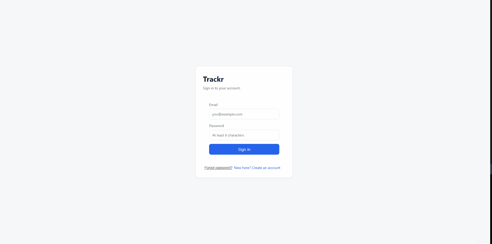
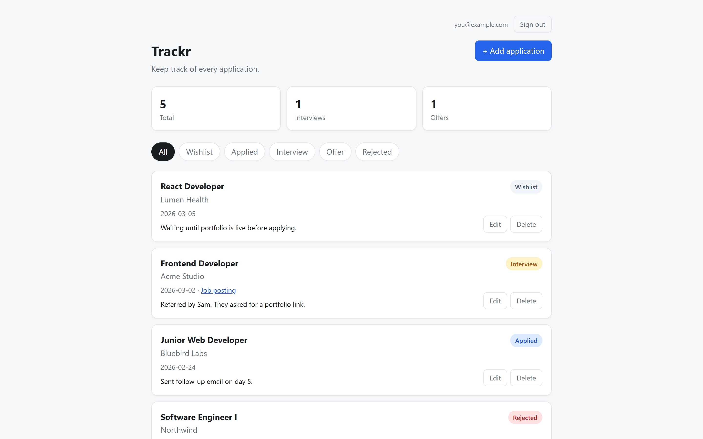
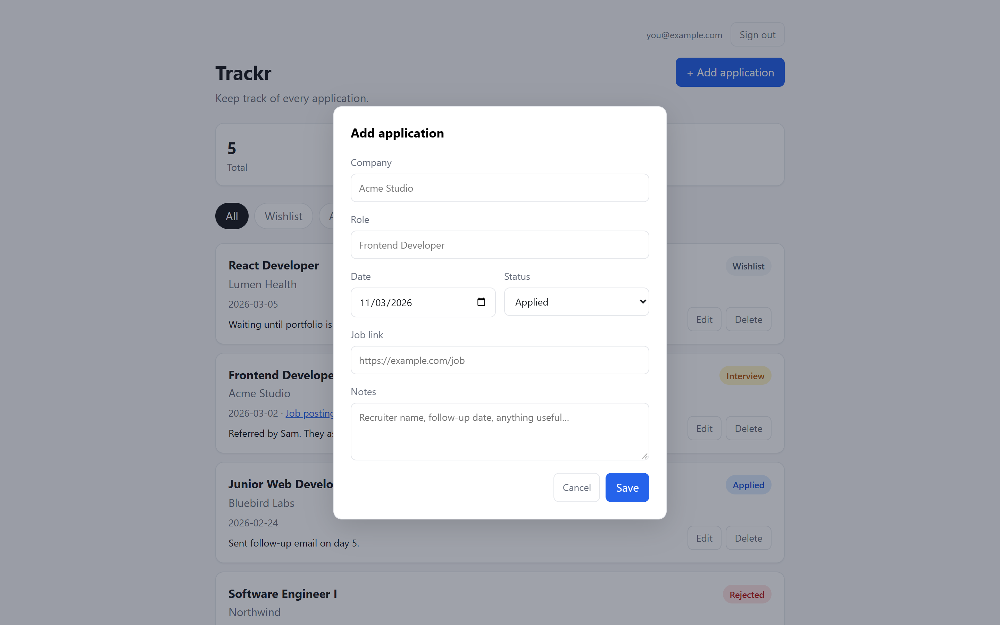

# Trackr

A job application tracker — built as a portfolio project to learn full-stack web development from the ground up.

**Live demo:** https://trackr-react.netlify.app/  
**Vanilla JS version:** https://trackr-vanilla.netlify.app/



## What it does

- Sign up / sign in with email
- Add, edit, and delete job applications
- Track status: Wishlist → Applied → Interview → Offer → Rejected
- Filter applications by status
- See stats: total applications, interviews, offers
- Data persists per-user in a real Postgres database

## Tech stack

- **Frontend:** React, Vite
- **Backend:** Supabase (Postgres, Auth, Row-Level Security)
- **Deploy:** Netlify

## How it works

Each user's applications live in a Postgres table with a `user_id` column. Supabase Row-Level Security enforces that requests from one user can never read or write another user's rows — the policy is enforced by the database itself, not the application code. So even if there were a bug in the frontend, one user's data wouldn't leak to another.

The app is a React SPA. Authentication state lives in a context provider; when a user signs in, an effect loads their applications from Supabase. Add/edit/delete operations write to the database first, then update local state from the confirmed response.

## Engineering decisions

**I built this app three times.**

1. **Vanilla HTML/CSS/JS.** Store applications in an array, save to `localStorage`, re-render the list from scratch after every mutation. This taught me the "state + render" pattern before I had a framework hiding it.

2. **React rewrite.** Same features, same design, different engine. The comparison made clear what React is actually buying: declarative rendering, automatic XSS escaping, component boundaries, and prop-based data flow. For an app this size, vanilla is fine — but the diff highlighted *why* frameworks exist.

3. **Supabase backend.** Replaced `localStorage` with a real Postgres database and real auth. The key design choice was **Row-Level Security over application-layer filtering** — the database refuses to return rows that don't belong to the requesting user, so a frontend bug can't become a data leak.

## Running locally

1. Clone this repo
2. `npm install`
3. Create `.env.local` with:
   ```
   VITE_SUPABASE_URL=your-project-url
   VITE_SUPABASE_PUBLISHABLE_KEY=your-anon-key
   ```
4. Run the SQL from `supabase/schema.sql` in your Supabase project's SQL editor
5. `npm run dev`

## Screenshots


